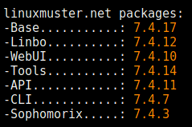
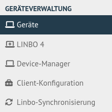
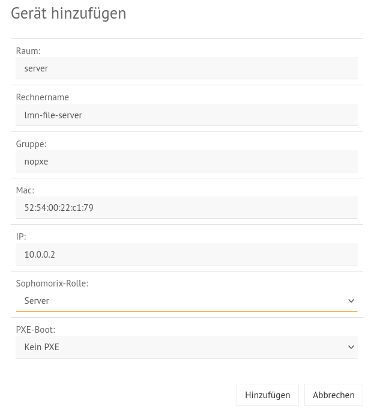
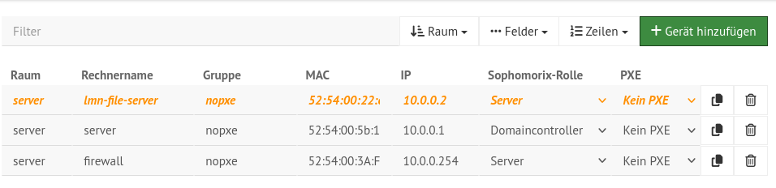
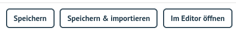
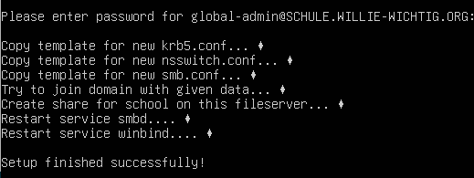
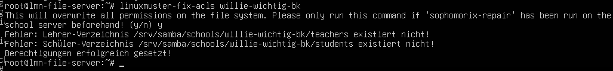

.. include:: /guided-inst.subst

.. _setup-file-server-label:

=================
Setup File-Server
=================

.. sectionauthor:: `@cweikl <https://ask.linuxmuster.net/u/cweikl>`_,

.. hint::

    Der Fileserver für linuxmuster.net 7.4 kann optional installiert werden (Drei-Server-Lösung). Es kann aber weiterhin wie bisher auch ein Weiterbetrieb als Zwei-Server-Lösung erfolgen. Wir empfehlen den Fileserver z.B. in einer eigenen VM zu installieren, da hierdurch deutliche Performancesteigerungen in Verbindung mit Samba erreicht werden. Dies empfehlen wir insbesondere mittleren bis größeren Schulen. Kleinere Schulen können problemlos linuxmuster.net 7.4 als Zwei-Server-Lösung weiterbetreiben.

    Grundsätzlich kann linuxmuster.net 7.4 weiterhin als Zwei-Server-Lösung betrieben werden und es kann jederzeit später eine Erweiterung / Umstellung auf den zusätzlichen File-Server erfolgen.

File-Server aufnehmen
=====================

Der File-Server muss zuerst als Gerät auf dem linuxmuster.net Server AD/DC als Gerät in die ``devices.csv`` aufgenommen werden.

``Variante A``

Melde Dich als Benutzer ``linuxadmin`` mit dem Passwort ``Muster!`` auf dem linuxmuster.net Server AD/DC an.

Für diese Anmeldung kannst Du die xterm.js Konsole von Proxmox verwenden, wenn Du unserer Anleitung gefolgt bist. Alternativ kannst Du Dich via ssh von einem anderen Rechner mit dem Server verbinden, wenn er sich im gleichen Netzwerksegment befindet.

Im Terminal wirst Du mit dem Erstbildschirm von linuxmuster.net v7.4 begrüßt und es werden die installierten Paketversionen von linuxmuster.net angezeigt.

   
   Welcome to lmn.net
   
Wechsel im Terminal zum Benutzer ``root`` mit

.. code::

   sudo -i

Rufe dort im Terminal die Datei auf und trage den File-Server mit seiner Funktion ``server`` ein:

.. code::

   # /etc/linuxmuster/sophomorix/default-school/devices.csv
   server;lmn-file-server;nopxe;52:24:00:22:c1:79;10.0.0.2;;;;server;;0;;;;SETUP;

Speichere die Änderungen in der Datei.

Rufe danach im Terminal folgenden Befehl auf:

.. code::

   linuxmuster-import-devices
   
``Variante B``

Melde Dich in der WebUI als Benutzer ``global-admin`` an und wähle den Menüpunkt ``Geräte``.

   
   WebUI: Rufe das Menü Geräte auf

Klicke auf Gerät hinzufügen und trage die Daten für Deinen File-Server ein.

   
   WebUI: Trage die Daten für den File-Server ein

Klicke auf ``Hinzufügen``. Deine Eintragungen werden Dir in der Liste noch farbig markiert angezeigt, da diese noch nicht importiert wurden.

   
   WebUI: Anzeige des neuen Eintrags in der Geräteliste
   
Übernehme nun die Eintragungen mit dem Button ``Speichern & Importieren``.

   
   WebUI: Übernehme den Eintrag mit Speichern & Importieren

Setup des File-Servers
======================

Melde Dich als Benutzer ``linuxadmin`` mit dem Passwort ``Muster!`` auf dem linuxmuster.net File-Server in der Konsole an.

Wechsel im Terminal zum Benutzer root mit

.. code::

   sudo -i

Rufe dort im Terminal das Setup-Programm für den File-Server auf:

.. code::

   linuxmuster-fileserver setup [-d DOMAIN] [-u USERNAME] [-p PASSWORD] [-s SCHOOL]
   
Das Setup benötigt folgende Optionen, die bei Aufruf anzugeben sind:

+-----------+---------------+-----------------+
| Parameter | Beschreibung  |   Vorgabewert   |
+===========+===============+=================+
|    -h     | Hilfeseite    |                 |
+-----------+---------------+-----------------+
|    -d     | Domäne des AD | linuxmuster.lan |
+-----------+---------------+-----------------+
|    -u     | Benutzername  | global-admin    |
|           | des Admins    |                 |
+-----------+---------------+-----------------+
|    -p     | Kennwort des  |                 |
|           | Admins        |                 |
+-----------+---------------+-----------------+
|    -s     | Schulname für | default-school  |
|           | die Freigaben |                 |
+-----------+---------------+-----------------+

Der vollständige Befehlsaufruf für das Setup lautet z.B. für die

 - *Domäne*: schule.willie-wichtig.org (wie beim Setup des AD/DC angegeben)
 - *Benutzername des Admins*: global-admin
 - *Kennwort des Admins*: ``-p`` auslassen, dann wird das Kennwort interaktiv abgefragt
 - *Schulname für Freigaben*: Wird ``-s`` ausgelassen, wird default-school genutzt

.. hint::

   Hast Du zuvor das Setup des linuxmuster.net AD/DC - Server durchlaufen, dann nutzt Du dort den Share ``default-school`` - unabhängig davon, wie Du beim Setup Deine Schule genannt hast. Du musst also für den File-Server diesen Share angeben oder den Parameter ``-s`` weglassen.

.. code::

   linuxmuster-fileserver setup -d schule.willie-wichtig.org -u global-admin -s default-school

Wurde das Setup erfolgreich ausgeführt, siehst Du folgende Bestätigung:

   
   File-Server: Erfolgreiches Setup
   
Auf dem File-Server findet sich nun das Verzeichnis:

.. code::

   /srv/samba/schools/default-school/

Freigaben übertragen
====================

1. Du musst nun die auf dem linuxmuster.net AD/DC Server vorhandenen Freigaben, auf den File-Server übertragen.
2. Danach aktualisierst Du die Freigaben.
3. Du lässt mit sophomorix die Berechtigungen im AD anpassen.
4. Auf dem File-Server passt Du die ACLs an.

``Schritt 1``

Übertrage zuerst vom linuxmuster.net AD/DC Server den ssh-key des Benutzer root auf den File-Server. Bislang kannst Du Dich nur als Benutzer linuxadmin auf dem File-Server via ssh anmelden. Du musst also nach der Übertragung den übertragenen ssh-key dem Benutzer root auf dem File-Server zuweisen.

Gib daher auf dem AD/DC Server zur Übertragung des ssh-keys in der Konsole folgenden Befehle ein:

.. code::

   root@server:~# ssh-copy-id -i .ssh/id_rsa.pub linuxadmin@10.0.0.2

- Der Key wurde nun auf dem File-Server dem User linuxadmin in ``~.ssh/authorized_keys`` hinzugefügt.
- Verbinde Dich nun vom AD/DC-Server via ssh auf den File-Server.

.. code::

   ssh root@10.0.0.2

- Wechsel auf dem File-Server in der Konsole zum Benutzer ``root``.
- Kopiere nun die Datei ``authorized_keys`` des Benutzers ``linuxadmin``:

.. code::

   cp /home/linuxadmin/.ssh/authorized_keys /root/.ssh/

``Schritt 2``

Danach installierst Du rsync jeweils auf dem ``AD/DC Server`` und auf dem ``File-Server`` mit

.. code::

   sudo apt install -y rsync
   
``Schritt 3``

Jetzt kannst Du den Inhalt des Freigabeordners auf dem AD/DC-Server zum File-Server synchronisieren.

Hierzu gibst Du als Benutzer root auf dem AD/DC-Server folgenden Befehl ein:

.. code::

   rsync -av --delete -e ssh /srv/samba/schools/default-school/ root@10.0.0.2:/srv/samba/schools/default-school/
   
Als Ziel ist auf dem ``File-Server`` der Schulname anzugeben, wie Du diesen zuvor mit dem linuxmuster-fileserver setup eingerichtet hattest.
   

Aktualisierung der Freigaben
============================

Melde Dich nun in der Konsole auf dem linuxmuster.net AD/DC Server an.

Wechsel im Terminal zum Benutzer root mit

.. code::

   sudo -i

Gib im Terminal zur Aktualisierung der Freigaben (Shares) folgende Befehle ein:
   
.. attention::

   Nachstehenden Befehl musst Du nur eingeben, wenn Du eine neue Installation von linuxmuster.net zusammen mit dem Fileserver durchführst. Hast Du bereits eine lmn v7.4 installiert / eingerichtet und fügst erst später den Fileserver hinzu, dann musst Du folgenden Befehl weglassen: ``net conf addshare $SCHOOL /srv/samba/schools/$SCHOOL/``

.. code::

   SCHOOL=default-school
   FQDN=$(ssh 10.0.0.2 "hostname -f")
   
   net conf addshare $SCHOOL /srv/samba/schools/$SCHOOL/
   net conf delparm $SCHOOL "guest ok"
   net conf delparm $SCHOOL "read only"
   net conf delparm $SCHOOL "path"
   net conf setparm $SCHOOL "msdfs root"  yes
   net conf setparm $SCHOOL "msdfs proxy"  //$FQDN/$SCHOOL
   net conf setparm $SCHOOL "hide unreadable"  yes

Abschluss
=========
   
Führe zum Abschluss der Integration noch folgenden Befehl auf dem linuxmuster.net ``AD/DC - Server`` aus:

.. code::

   sophomorix-repair --all
   
Danach wechselst Du zur Konsole auf dem ``File-Server`` und gibst dort als Benutzer root folgenden Befehl ein:

.. code::

   linuxmuster-fix-acls default-school
   
Du musst dem Befehl den Schulnamen übergeben, wie Du diesen für den File-Server festgelegt hast. Hast Du keinen festgelegt, nutzt Du default-school.

Bei erfolgreicher Anwendung siehst Du diese Ausgabe:

   
   File-Server: Setze die ACLs

Fehlerbehebung
==============

Sollten Fehler auftreten, können zur Behebung folgende Befehle hilfreich sein:

1. Prüfe auf dem AD/DC-Server, ob der File-Server läuft:

.. code::

   linuxmuster-fileserver status

2. Prüfe, ob Benutzer und Grupppen auf dem File-Server gelesen werden können:

.. code::

   # user
   wbinfo -u
   # group
   wbinfo -g

3. Prüfe, ob Clients vom File-Server aus erreicht werden können.

Geschwindigkeitstests
=====================

Wurde der File-Server erfolgreich eingerichtet, kannst Du Tests zur Überprüfung der Geschwindigkeit durchführen. Dazu rufst Du auf dem AD/DC-Server eine Konsole auf und gibst folgenden Befehl an:

.. code::

   smbclient //<target>/<share> -U global-admin -k -c "put random-1G;rm random-1G"

Es wird eine Datei mit zufälligem Inhalt und einer Dateigröße von 1GiB auf die Freigabe übertragen und danach direkt wieder gelöscht. Beobachte die dabei angegebene Übertragungszeit. Wiederhole den Test mehrfach.

.. hint::

   Passe <target> auf Deinen File-Server und <share> auf Deine Freigabe an.

Samba DFS
=========

Das Distributed File System (DFS) arbeitet so, dass die Anfrage eines Client an eine DFS-PFad (z.B. \\server\default-school) von Samba mit einem DFS-Verweis beantwortet wird. Dieser Verweis teilt dem Client mit, wo sich aktuell die angefragten Daten befinden. Üblicherweise entspricht dies einem UNC - Pfad wie z.B. \\lmn-fileserver.linuxmuster.lan\default-school.

Der Client verbindet sich direkt mit dem Zielserver und greift direkt auf die Dateien zu, so als wenn diese Bestandteil des ursprünglichen DFS-Pfads wären. Die Umleitung erfolgt nahtlos im Hintergrund, so dass ein Nutzer immer den einheitlichen DFS-Namensraum sieht.

Kernaspekte:

 - Clients greifen auf ein sog. virtuelles Root-Verzeichnis (``\domain\dfsroot``) anstelle auf ein Root-Verzeichnis ``/``  eines einzelnen Servers zu.
 - Samba leitet den Client zu dem richtigen Server anhand des DFS-Verweises um.
 - Nach der Umleitung des Clients erfolgt der Dateizugriff wie bei einer sonstigen Freigabe eines Samba-Shares.

